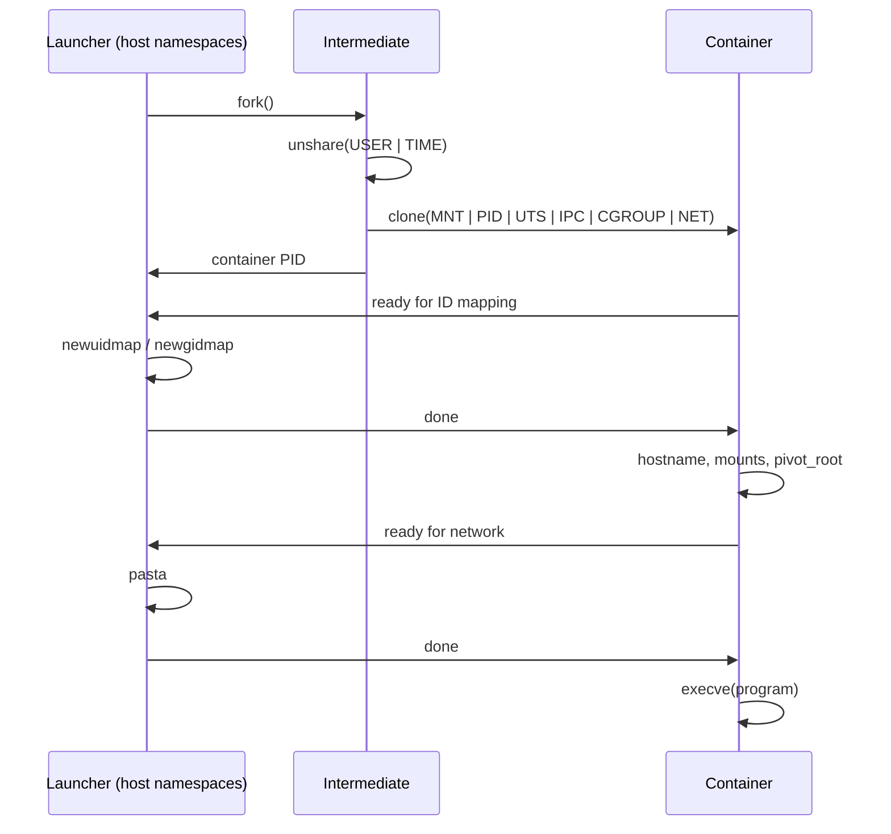

# Trucker

> Rootless Linux container runtime in C: the trucker who delivers containers to the dockers.

*In the interest of transparency: this README was written with the help of Claude, Anthropic's AI assistant. The code is my own, there is no code from any AI system in the project; Claude was used as a learning aid.*

> ⚠️ **Educational project, not for production use.** Trucker is a solo learning project built to understand namespaces, cgroups and capabilities by implementing them. It has limitations in features, security and robustness compared to [runc](https://github.com/opencontainers/runc) or [crun](https://github.com/containers/crun).

## Features

Trucker is complete in its **minimal version**:

- **Rootless**: no root needed on the host
- **All eight namespaces**: user, mount, PID, UTS, IPC, cgroup, network, time (no clock offsets yet)
- **UID/GID mapping** with `newuidmap`/`newgidmap`: the container's root is you, other IDs use your subordinate range
- **Isolated filesystem** with `pivot_root`, plus `/proc`, `/sys`, `/dev`, `/dev/pts`, `/dev/shm`, `/dev/mqueue`, `/sys/fs/cgroup`
- **Its own cgroup**, in a delegated systemd scope
- **Network access** with [`pasta`](https://passt.top/)
- **A random hostname** (`ctr-xxxxxxxx`)

## Requirements

- Linux with cgroup v2 and unprivileged user namespaces
- A systemd user session (`systemd-run --user`)
- `newuidmap`/`newgidmap`, and an entry for your user in `/etc/subuid` and `/etc/subgid`
- [`pasta`](https://passt.top/) (package `passt`), `gcc` and `make`

## Usage

```bash
make
export TRUCKER="$(pwd)"
export PATH="$TRUCKER:$PATH"
trucker deliver <environment> <program> [args...]
```

`<environment>` is a directory that becomes the container's `/`, and `<program>` a path inside it.

## How it works

Three processes are needed, because the UID/GID mapping and the network must be configured from **outside** the container's user namespace:



- **The launcher** stays in the host's namespaces, so it can run `newuidmap`, `newgidmap` and `pasta` on the container.
- **The intermediate** creates the user namespace, then the container. The `unshare()` then `clone()` pattern is also what the time namespace requires.
- **The container** makes its mounts private, mounts everything inside the future root, calls `pivot_root(".", ".")`, detaches the old root, and runs the program.

Mounts are described in tables and applied by generic functions, with the flags used by runc. The devices (`/dev/null`, `/dev/zero`, `/dev/full`, `/dev/random`, `/dev/urandom`, `/dev/tty`) are bind-mounted from the host, since `mknod()` is forbidden in a user namespace.

## Design choices

- **A runtime, not a manager.** Like runc and crun, Trucker takes a directory and runs a program in it. Images, environment variables and the user inside the container belong to the layer above. The runtime only provides what comes from the kernel (`/proc`, `/sys`, `/dev`...).
- **Capabilities stay inside the container.** The container keeps all capabilities in its own user namespace and has none on the host: capabilities never apply to an ancestor namespace. Reducing them inside is a planned hardening step.
- **systemd scopes, not PID files.** A process can change PID by daemonizing, but cannot leave its cgroup. Stopping the scope stops the whole container.
- **External setup scripts.** The network (`setup/config_net_ns.sh`) and the ID mapping (`setup/config_id_map.sh`) can be adapted without touching the runtime.

## Known limitations

- **The exit code** are not yet properly handled
- **The launcher can hang** if the container fails early: pipes lack `O_CLOEXEC` and unused ends are not closed yet.
- **Memory management and error handling** are incomplete.
- **No seccomp filter**, no capability reduction inside the container, no masked paths in `/proc` and `/sys`.
- **No terminal of its own**: the container uses the host's terminal directly.
- **No overlay**: changes made by a container stay in the environment directory.
- **PID 1 ignores `SIGTERM`**, so stopping a scope may wait for systemd's timeout.

## Future additions planned

- **Correctness**: exit codes, pipe handling, closing inherited file descriptors before `execve()`, `SIGTERM` handling, `PR_SET_PDEATHSIG`
- **Code quality**: memory and error handling, `snprintf()`, splitting the code into thematic files
- **Options**: `--hostname`, `--bind`, `--env-file`/`-e`, `--init`, `tmpfs` sizes, network options and other options
- **Hardening**: capability reduction, seccomp, masked paths, a dedicated pseudo-terminal, a minimal init as PID 1
- **Persistent containers**: one overlay and one UID range per container, with create/start/stop/delete commands, so that an escape reaches neither my account nor the other containers

## References

- `man 7` pages: `namespaces`, `user_namespaces`, `mount_namespaces`, `capabilities`, `cgroups`
- [OCI runtime specification](https://github.com/opencontainers/runtime-spec)
- [Linux containers in 500 lines of code](https://blog.lizzie.io/linux-containers-in-500-loc.html), by Lizzie Dixon
- [crun](https://github.com/containers/crun), [runc](https://github.com/opencontainers/runc), [passt / pasta](https://passt.top/)
